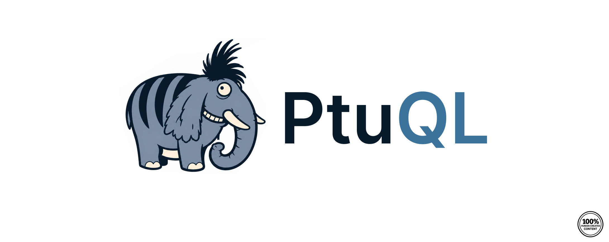

<div align="center">

<b>Как известно, мир стоит на трёх слонах</b>

</div>

## Описание

Передавая сверх-безопасная СУБД. 
Механизмы хеширования основаны на Крипто-Яйцах.


В связи с тем, что слон всего один, СУБД - не реляционная.
Но для хороших программ одной таблицы должно хватить.

Создание экземпляра:

```python
pql = PtuQL([
        Column("id", DataType.PrimaryKey),
        Column("date year", DataType.Number),
        Column("name", DataType.String),
        Column("age", DataType.Number),
        Column("company", DataType.String),
    ])
```

Заполнение:

```python
pql.insert_list([
    [Literals.Auto, 2026, "Fedor", 19, "SPO ENTERPRICE LLC"],
    [Literals.Auto, 2026, "Nikas", 19, "SPO ENTERPRICE LLC"],
    [Literals.Auto, 2026, "Ivan L.", 19, "SPO ENTERPRICE LLC"],
    [Literals.Auto, 2026, "Albert", 19, "SPO ENTERPRICE LLC"],
])
```

Пример запроса:

```python
rows = pql.select(Query("company", QueryOperator.Equal, "SPO ENTERPRICE LLC"))
```

Подробнее можно изучить API в [main.py](main.py)

## Запуск

```bash
uv run ./main.py
```